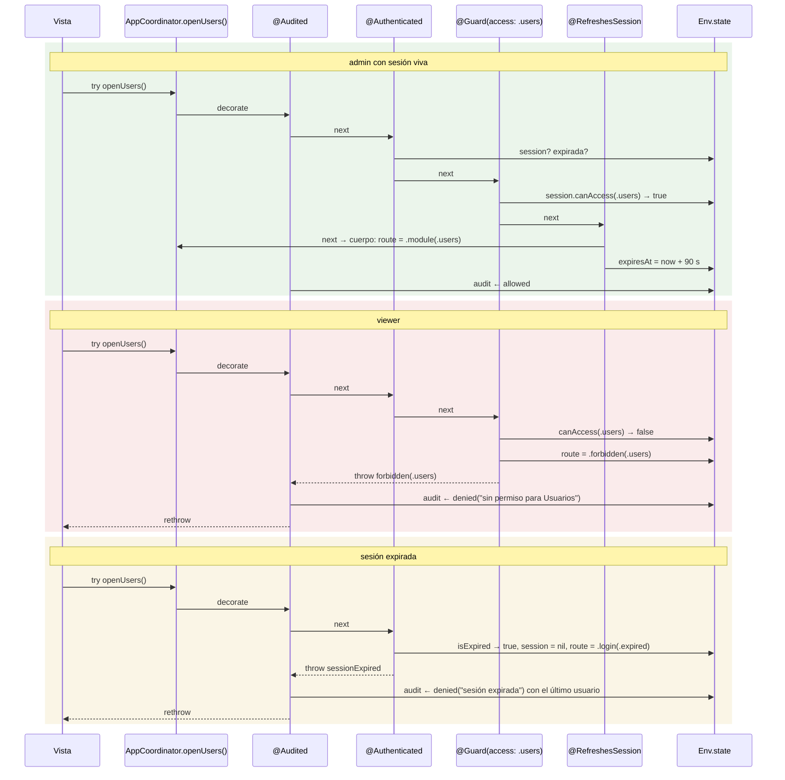
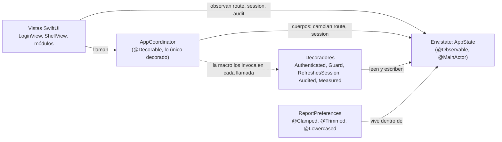

# AdminApp: guardianes de navegación con anotaciones

App de administración con roles, hecha como una web con guardias de ruta: sesión, expiración,
permisos por módulo y auditoría. Todo el comportamiento transversal son anotaciones apiladas
sobre el coordinador; las vistas solo llaman métodos y reaccionan a la ruta.

```bash
swift run --package-path Examples/AdminApp    # abre la ventana en macOS
swift test --package-path Examples/AdminApp   # guardianes probados sin UI
```

Usuarios de prueba: `admin`, `editor`, `viewer` (la contraseña es el mismo nombre).

## La pila

```swift
@Audited                      // 1. registra todo, incluidos los rechazos de abajo
@Authenticated                // 2. sesión viva o redirige al login (con motivo)
@Guard(access: .users)        // 3. rol con acceso o pantalla "sin permiso"
@RefreshesSession             // 4. renueva la sesión solo si el cuerpo terminó bien
public func openUsers() throws {
    Env.state.route = .module(.users)
}
```

El orden importa y se lee de arriba abajo. Si `@Audited` fuera el último, nunca vería un
rechazo porque los guardianes de arriba detienen la cadena antes de llegar a él.

## Cómo fluye una acción protegida

Tres caminos posibles para `openUsers()`, según quién la llame y en qué estado esté la sesión:



En el segundo y tercer camino el cuerpo nunca se ejecuta y `@RefreshesSession` nunca ve nada. `@Audited` sí lo ve todo porque es el más externo.

## Quién habla con quién



Los decoradores no conocen al coordinador ni a las vistas: solo al estado. Por eso se prueban con el coordinador real y un `AppState` nuevo, sin UI.

## Qué enseña cada pieza

| Pieza | Protocolo | Qué muestra |
| --- | --- | --- |
| `Authenticated`, `Guard` | `GuardDecorator` (vía `UIGuard`) | Guardianes: comprueban y lanzan; redirigen cambiando la ruta |
| `RefreshesSession`, `Audited` | `HookDecorator` | Notificaciones: reaccionan al resultado sin tocar el cuerpo |
| `Measured` | `Decorator` | Transparente, mide y publica la duración |
| `Clamped`, `Trimmed`, `Lowercased` | `PropertyDecorator` | Normalizan las preferencias de reportes al asignarlas |
| `UIGuard` | protocolo propio | Cómo construir tu propia capa encima del núcleo: un solo salto al main actor |

Los decoradores no reciben `self`: consultan `Env.state`, igual que una anotación de Java habla
con el contexto y no con el objeto. El menú lateral usa la misma `Session.canAccess` que
`@Guard`, así que lo que se muestra y lo que se permite nunca se desincronizan.

## Recorrido guiado

Abre la app con `swift run --package-path Examples/AdminApp` y sigue estos pasos. Debajo de cada uno, lo que ocurre por dentro.

**1. Entra como `viewer`.** La pantalla de login trae `viewer` / `viewer`. Pulsa Entrar.
`login(user:password:)` consulta `Directory.authenticate`, crea la `Session` con el rol `viewer` y 90 s de vida, y pone la ruta en `.module(.inventory)`. `@Audited` anota la entrada en verde.

**2. Mira el menú lateral.** Solo aparece Inventario.
`visibleModules` filtra con `session.canAccess`, la misma política que usa `@Guard`. Abajo, el banner muestra el usuario, sus roles y la cuenta regresiva de la sesión.

**3. Pulsa "Forzar acceso a Usuarios".** Pantalla roja "Sin permiso".
`openUsers()` entra por `@Audited`, pasa `@Authenticated`, y `@Guard(access: .users)` lo detiene: cambia la ruta a `.forbidden(.users)` y lanza. El cuerpo nunca corre. Ve a Auditoría: el intento está en rojo con "sin permiso para Usuarios".

**4. Vuelve al inventario y pulsa "Simular expiración".** Luego cualquier módulo o botón de prueba.
`simulateExpiry()` pone `expiresAt` en el pasado. La siguiente acción protegida llega a `@Authenticated`, que borra la sesión, manda la ruta a `.login(.expired)` y lanza. Verás el login con "Tu sesión expiró". `@Guard` ni se ejecutó: está más adentro en la pila. En Auditoría, la entrada conserva el usuario aunque la sesión ya no exista.

**5. Entra como `editor` y abre Reportes.** Escribe `"  TORNILLO "` en el filtro y sube el tamaño de página por encima de 100. Pulsa Cargar.
`loadReports()` pasa los guardianes y `@Measured` mide la carga; la vista muestra la duración. Las preferencias son un `struct` decorado: `@Trimmed @Lowercased` convirtió el filtro en `tornillo` y `@Clamped(5...100)` acotó el tamaño. Observa el banner: cada acción permitida renovó la sesión a 90 s (`@RefreshesSession`).

**6. En Auditoría, pulsa "Exportar CSV".** Como `editor`, rechazo.
`exportAudit()` lleva `@Guard(access: .reports, .users)`: exige acceso a los dos módulos. Sal, entra como `admin` y repite: se escribe un CSV en el directorio temporal y la ruta queda en pantalla.

**7. Cierra sesión.** El login muestra "Sesión cerrada" y el menú queda vacío.

## Estructura

```
Sources/AdminAppCore/
  Domain/        Role, Module (con su política), Session, Route, GuardError, AuditEntry, ReportPreferences
  App/           AppState (@Observable) y Env; AppCoordinator (lo único decorado)
  Decorators/    un archivo por anotación, con su línea de registro al final
  UI/            vistas SwiftUI; llaman al coordinador y reaccionan a la ruta
Sources/AdminApp/  ejecutable macOS (@main)
Tests/             guardianes contra el coordinador real, sin UI
```

## Para probar a mano

En el menú lateral, bajo "Probar guardianes": forzar acceso a Usuarios o Reportes con un rol
que no lo tiene, y simular la expiración de la sesión. La pantalla de Auditoría muestra cada
intento con su resultado; "Exportar CSV" exige acceso a Reportes y Usuarios a la vez.

## iOS

`AdminAppCore` compila para iOS 17. Para correrlo en el simulador crea un proyecto de app en
Xcode, añade este paquete y usa `AdminRootView()` como vista raíz.
