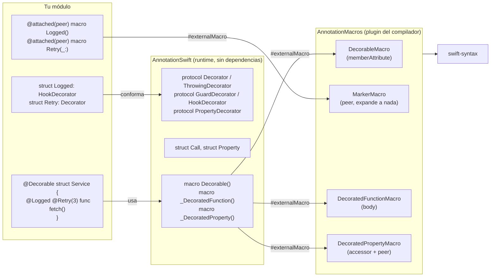
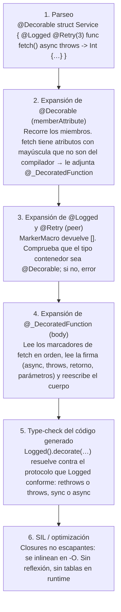
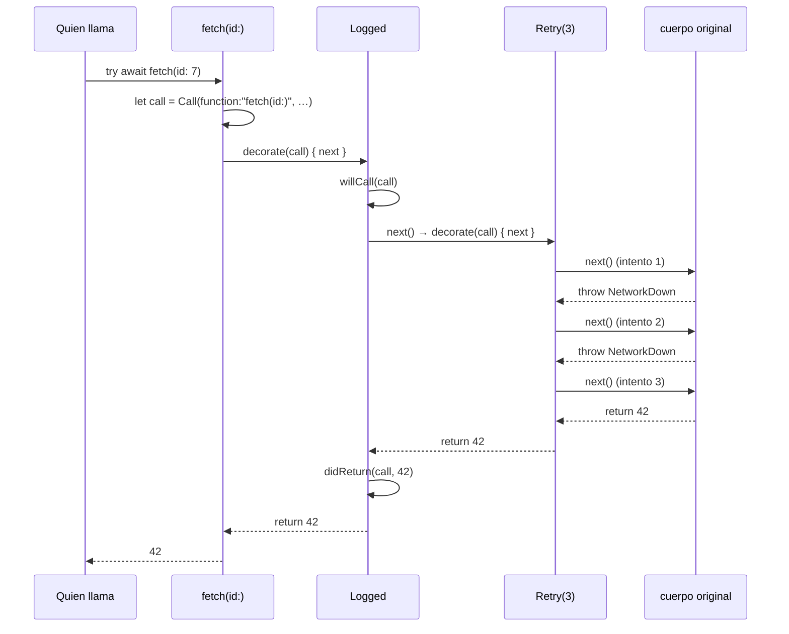
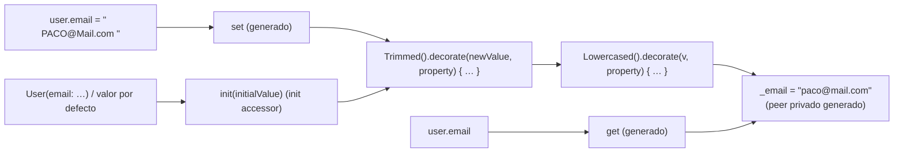

# experimental-annotation-swift


[](https://github.com/fsaldivar-dev/experimental-annotation-swift/actions/workflows/ci.yml)

[](https://github.com/fsaldivar-dev/experimental-annotation-swift/stargazers)

Anotaciones al estilo de Java para Swift: decoradores que se **crean en un archivo** y se **apilan** sobre funciones y propiedades.

```swift
@Decorable
struct Service {
    @Logged
    @Retry(3)
    func fetch() async throws -> Data { … }

    @Trimmed
    @Lowercased
    var email: String
}
```

`Logged`, `Retry`, `Trimmed` y `Lowercased` no vienen en la librería: los escribes tú. La librería pone el mecanismo.

## Quick Start

Cinco minutos: instalar, escribir un decorador, apilarlo y verlo correr.

**1. Añade la dependencia** en tu `Package.swift` (Swift 6.2+):

```swift
dependencies: [
    .package(url: "https://github.com/fsaldivar-dev/experimental-annotation-swift", from: "1.0.0")
],
targets: [
    .executableTarget(
        name: "MiApp",
        dependencies: [.product(name: "AnnotationSwift", package: "experimental-annotation-swift")]
    )
]
```

**2. Escribe tu primer decorador.** Un tipo con el comportamiento y una línea que lo registra como anotación. `HookDecorator` te da los ganchos "antes / después / falló":

```swift
// Logged.swift
import AnnotationSwift

struct Logged: HookDecorator {
    func willCall(_ call: Call) { print("→ \(call)") }
    func didReturn(_ call: Call, result: Any) { print("← \(call) = \(result)") }
    func didThrow(_ call: Call, error: any Error) { print("✗ \(call): \(error)") }
}

@attached(peer) macro Logged() = #externalMacro(module: "AnnotationMacros", type: "MarkerMacro")
```

**3. Escribe el segundo**, uno que controle si el cuerpo se ejecuta. Un guardián solo necesita `check`:

```swift
// Authorized.swift
import AnnotationSwift

enum AccessError: Error { case forbidden }

struct Authorized: GuardDecorator {
    nonisolated(unsafe) static var currentRole = "viewer"
    let role: String
    init(_ role: String) { self.role = role }

    func check(_ call: Call) throws {
        guard Self.currentRole == role else { throw AccessError.forbidden }
    }
}

@attached(peer) macro Authorized(_ role: String) = #externalMacro(module: "AnnotationMacros", type: "MarkerMacro")
```

**4. Apílalos.** `@Decorable` en el tipo activa los marcadores; el orden de arriba abajo es el orden de envoltura:

```swift
// main.swift
import AnnotationSwift

@Decorable
struct Admin {
    @Logged
    @Authorized("admin")
    func deleteEverything() throws -> String { "borrado" }
}

let admin = Admin()
Authorized.currentRole = "viewer"
_ = try? admin.deleteEverything()      // → Admin.deleteEverything()  ✗ Admin.deleteEverything(): forbidden
Authorized.currentRole = "admin"
print(try admin.deleteEverything())   // → … ← … = borrado  borrado
```

**5. Corre.**

```bash
swift run
```

Eso es todo el mecanismo: `Logged` vio el rechazo porque está por fuera de `Authorized`; invierte las dos líneas y el log solo aparecerá cuando el guardián deje pasar. Para propiedades el patrón es el mismo con `PropertyDecorator` (ver abajo). Si quieres verlo en una app real, salta a [Cómo funciona la demo](#cómo-funciona-la-demo).

## Instalación

Swift Package Manager, Swift 6.2 o superior (Xcode 26.1+):

```swift
dependencies: [
    .package(url: "https://github.com/fsaldivar-dev/experimental-annotation-swift", from: "1.0.0")
]
```

y en tu target, `.product(name: "AnnotationSwift", package: "experimental-annotation-swift")`.

## Crear un decorador

Un decorador es un tipo normal más una línea que lo registra como anotación. Nada de swift-syntax, nada de plugins propios.

### De función: observar la llamada

Para registrar, medir o auditar basta con los ganchos de `HookDecorator`:

```swift
import AnnotationSwift

struct Logged: HookDecorator {
    func willCall(_ call: Call) { print("→ \(call)") }
    func didReturn(_ call: Call, result: Any) { print("← \(call) = \(result)") }
    func didThrow(_ call: Call, error: any Error) { print("✗ \(call): \(error)") }
}

@attached(peer) macro Logged() = #externalMacro(module: "AnnotationMacros", type: "MarkerMacro")
```

### De función: controlar la continuación

Cuando necesitas decidir si el cuerpo se ejecuta, cuántas veces o con qué resultado, implementa `Decorator`. Recibes `next`, que es "lo que sigue en la cadena": el siguiente decorador o el cuerpo original.

```swift
struct Retry: Decorator {
    let attempts: Int
    init(_ attempts: Int) { self.attempts = attempts }

    func decorate<Out>(_ call: Call, _ next: () throws -> Out) rethrows -> Out {
        for _ in 1..<attempts { if let out = try? next() { return out } }
        return try next()
    }

    func decorate<Out>(_ call: Call, isolation: isolated (any Actor)?,
                       _ next: () async throws -> Out) async rethrows -> Out {
        for _ in 1..<attempts { if let out = try? await next() { return out } }
        return try await next()
    }
}

@attached(peer) macro Retry(_ attempts: Int) = #externalMacro(module: "AnnotationMacros", type: "MarkerMacro")
```

Hay dos variantes porque una función síncrona no puede esperar: la macro usa la que corresponde a la firma de cada función decorada. El parámetro `isolation` hace que el decorador corra en el mismo actor que la función, así `next` puede tocar estado de `@MainActor` o de un `actor` sin cruzar fronteras.

### De función: detener la ejecución (guardianes)

`Decorator` es `rethrows`: solo lanza lo que lance `next`, por eso sirve en funciones que no lanzan. Un guardián necesita lanzar por su cuenta; para eso están `ThrowingDecorator` y, para el caso común, `GuardDecorator`:

```swift
struct Authorized: GuardDecorator {
    let role: Role
    init(_ role: Role) { self.role = role }

    func check(_ call: Call) throws {
        guard Session.current?.roles.contains(role) == true else { throw AccessError.forbidden }
    }
}

@attached(peer) macro Authorized(_ role: Role) = #externalMacro(module: "AnnotationMacros", type: "MarkerMacro")
```

Las funciones con un guardián deben ser `throws`; si no lo son, el compilador rechaza el código generado.

### De propiedad

Envuelve la asignación. El valor nuevo atraviesa la cadena y el último `next` lo almacena.

```swift
struct Trimmed: PropertyDecorator {
    func decorate(_ value: String, _ property: Property, next: (String) -> String) -> String {
        next(value.trimmingCharacters(in: .whitespacesAndNewlines))
    }
}

@attached(peer) macro Trimmed() = #externalMacro(module: "AnnotationMacros", type: "MarkerMacro")
```

Un decorador genérico sirve para cualquier tipo que cumpla su restricción:

```swift
struct Clamped<Value: Comparable>: PropertyDecorator {
    let range: ClosedRange<Value>
    init(_ range: ClosedRange<Value>) { self.range = range }
    func decorate(_ value: Value, _ property: Property, next: (Value) -> Value) -> Value {
        next(min(max(value, range.lowerBound), range.upperBound))
    }
}

@attached(peer) macro Clamped<Bound: Comparable>(_ range: ClosedRange<Bound>) = #externalMacro(module: "AnnotationMacros", type: "MarkerMacro")
```

```swift
@Decorable
struct Settings {
    @Clamped(0.0...1.0) var volume: Double = 3   // se guarda 1.0
}
```

## Por dentro

Esta sección baja al nivel del compilador y de la ejecución: qué piezas hay, qué hace cada una en cada fase, y qué código termina corriendo.

### Arquitectura



El plugin es genérico: no contiene ningún decorador y no se recompila cuando creas uno. Tu módulo solo necesita `import AnnotationSwift`; SwiftPM carga el plugin para cualquier módulo que dependa de la librería, por eso puedes declarar marcadores desde tu propio código.

### Fase de compilación



Lo que la macro de cuerpo genera, textualmente, para `@Logged @Retry(3) func fetch(id: Int) async throws -> Int`:

```swift
func fetch(id: Int) async throws -> Int {
    let __annotation_call = AnnotationSwift.Call(
        function: "fetch(id:)", type: "Service",
        file: "MiApp/Service.swift", line: 12,
        arguments: [AnnotationSwift.Call.Argument(name: "id", label: "id", value: id)]
    )
    return try await Logged().decorate(__annotation_call, isolation: #isolation) { () async throws -> Int in
        return try await Retry(3).decorate(__annotation_call, isolation: #isolation) { () async throws -> Int in
            // cuerpo original, sin tocar
        }
    }
}
```

Decisiones de bajo nivel que hay detrás:

- **Por qué un marcador y un procesador.** Swift admite una sola body macro por función y una sola accessor macro por propiedad. Dos macros "reales" apiladas no compilan. Los marcadores no generan código; `@Decorable` lee sus nombres y argumentos como texto y los convierte en `Logged()` y `Retry(3)`. Es el mismo patrón con el que `@Observable` adjunta `@ObservationTracked` a cada propiedad.
- **Cómo reconoce un marcador.** Atributo con mayúscula inicial que no está en la lista de atributos del compilador y del SDK (`@MainActor`, `@IBAction`, `@State`, …). Los de minúscula (`@available`, `@objc`, `@inlinable`) y los de prefijo `_` se descartan.
- **`try` y `await` se emiten según la firma.** `Decorator.decorate` es `rethrows`: si la función no lanza, la macro no escribe `try` y el compilador acepta la llamada. `ThrowingDecorator.decorate` es `throws`: en una función que no lanza, el código generado no compila, que es el error correcto.
- **`isolation: #isolation`.** El `decorate` async recibe el actor actual como parámetro `isolated`. Así el decorador corre en el mismo actor que la función, y `next`, que captura `self`, no cruza ninguna frontera: Swift 6 lo acepta sin `Sendable`.
- **El cuerpo original se mueve a un closure** con la firma explícita `() async throws -> Int`. Un `return` dentro devuelve del closure, que es exactamente devolver de la función. `guard`, `defer`, `inout` y `mutating` funcionan porque el closure no es escapante.
- **`Call` se construye por llamada** con los argumentos reales. Los parámetros de tipo función se omiten porque un closure no escapante no cabe en `Any`.

### Fase de ejecución



Cada decorador decide cuántas veces llama a `next`: `Logged` una, `Retry` hasta tres, un guardián ninguna si niega. El orden de apilado es el orden de anidación: el primero es el más externo y ve el resultado final; el último ve el cuerpo tal cual.

Costo: una llamada por decorador y un closure por nivel, ambos no escapantes. No hay reflexión ni despacho dinámico más allá del que tú escribas en tu decorador; con optimización el compilador inlinea la cadena.

### Propiedades: dónde queda el almacenamiento



`@Decorable` adjunta `@_DecoratedProperty`, que tiene dos roles: como *accessor macro* convierte `var email: String` en una propiedad computada con `init`, `get` y `set`; como *peer macro* añade `private var _email: String` con el inicializador original. El `init` accessor, con `@storageRestrictions(initializes: _email)`, hace que el inicializador memberwise siga existiendo y que el valor por defecto también atraviese la cadena. Es la misma técnica que usa `@Observable`, y por eso una propiedad decorada no puede vivir dentro de una clase `@Observable`: las dos macros quieren generar los accesores.

### Diagnósticos en compilación

| Situación | Mensaje |
| --- | --- |
| Marcador en un tipo sin `@Decorable` | `'@Logged' has no effect: add @Decorable to 'Service'` |
| Marcador fuera de un tipo | `'@Logged' has no effect here: decorators can only be applied to members of a @Decorable type` |
| `let`, computada, `static`, `lazy` | `decorators cannot be applied to a 'let' constant; use 'var'` y similares |
| Propiedad en extensión | `decorators cannot be applied to properties declared in an extension` |
| `throws(E)` tipado | `decorators do not support typed throws; declare the function as 'throws'` |
| `init`, `subscript` | `decorators can only be applied to functions and stored properties` |

## Reglas y límites

- `@Decorable` va en el tipo o en la extensión que contiene los miembros decorados.
- **Funciones**: métodos de instancia o estáticos, síncronos o `async`, con o sin `throws`, genéricos, `mutating`, con `inout`. No se admiten `init`, `subscript` ni `throws(E)` tipado.
- **Propiedades**: solo `var` almacenadas de instancia. No `let`, computadas, `static`, `lazy`, ni propiedades declaradas en una extensión.
- Todo atributo con mayúscula inicial que no sea del compilador o del SDK se considera un marcador. Un actor global propio (`@MiActor`) sobre un miembro decorado provocará un error de compilación; déjalo en el tipo.
- Los parámetros de tipo función se omiten de `Call.arguments` porque un closure no escapante no se puede guardar.
- `Call` no es `Sendable` porque transporta los argumentos reales. Extrae lo que necesites antes de cruzar un aislamiento.
- Una propiedad decorada no puede vivir en una clase `@Observable`: ambas macros quieren generar los accesores. Decora un `struct` y guárdalo en la clase observable.

## Casos de uso

Una anotación decora cualquier comportamiento, no solo valida. Estas son las familias que salen naturalmente del mecanismo, con el protocolo que las resuelve. Ninguna viene incluida: cada una es un archivo tuyo.

### Guardianes: deciden si el cuerpo se ejecuta

| Anotación | Qué hace cuando niega | Protocolo |
| --- | --- | --- |
| `@Authenticated`, `@Authorized(.admin)`, `@Guard(access: .users)` | Lanza y, si quieres, redirige | `GuardDecorator` |
| `@RequiresNetwork`, `@FeatureFlag("newCheckout")` | Lanza con motivo claro | `GuardDecorator` |
| `@Precondition { amount > 0 }` | Valida argumentos leyendo `call.arguments` | `GuardDecorator` |
| `@Debounced(300)`, `@SingleFlight` | Ignora la llamada si hay otra en curso | `Decorator` (funciones `Void`) |
| `@Cached(ttl: 60)`, `@Once` | Devuelve lo guardado sin ejecutar el cuerpo | `Decorator` |
| `@Fallback(default: [])` | Atrapa el error y devuelve un valor | `Decorator` |

```swift
struct RequiresNetwork: GuardDecorator {
    func check(_ call: Call) throws {
        guard Reachability.isOnline else { throw NetworkError.offline }
    }
}
```

### Notificaciones: avisan de lo que ocurrió

| Anotación | Cuándo dispara | Protocolo |
| --- | --- | --- |
| `@Logged`, `@Audited` | Antes, al devolver y al fallar | `HookDecorator` |
| `@Analytics("checkout_completed")`, `@Haptic(.success)`, `@Notifies(.cartUpdated)` | Al terminar bien | `HookDecorator.didReturn` |
| `@ReportsErrors`, `@Toast("No pudimos guardar")` | Al fallar | `HookDecorator.didThrow` |
| `@Measured`, `@Signpost` | Durante: abre y cierra un intervalo | `Decorator` |
| `@RefreshesSession` | Al terminar bien, con efecto en el entorno | `HookDecorator` |

```swift
struct Analytics: HookDecorator {
    let event: String
    init(_ event: String) { self.event = event }
    func didReturn(_ call: Call, result: Any) {
        Tracker.send(event, properties: call.arguments.map { ($0.label ?? $0.name, "\($0.value)") })
    }
}
```

### Resiliencia: controlan la continuación

| Anotación | Qué hace con `next` | Protocolo |
| --- | --- | --- |
| `@Retry(3, backoff: .milliseconds(200))` | Lo llama varias veces | `Decorator` |
| `@Timeout(.seconds(2))` | Lo cancela si tarda | `ThrowingDecorator` |
| `@CircuitBreaker(failures: 5)` | Deja de llamarlo tras N fallos | `ThrowingDecorator` |
| `@RateLimited(perMinute: 10)` | Lo rechaza si se excede la cuota | `ThrowingDecorator` |
| `@Transactional` | `begin` antes, `commit` si devuelve, `rollback` si lanza | `Decorator` |

El orden importa y es tuyo: `@Transactional @Retry(3)` reintenta dentro de una sola transacción; `@Retry(3) @Transactional` abre una transacción nueva por intento.

### Propiedades: envuelven la asignación

| Anotación | Efecto | Protocolo |
| --- | --- | --- |
| `@Trimmed`, `@Lowercased`, `@Clamped(0...100)` | Transforman el valor antes de guardarlo | `PropertyDecorator` |
| `@Email`, `@Matches(/\d{5}/)` | Validan; en una propiedad opcional, rechazan con `nil` | `PropertyDecorator` |
| `@Persisted("key")` | Guarda en `UserDefaults` en cada asignación | `PropertyDecorator` |
| `@Audited`, `@Broadcasts(.themeChanged)` | Avisan del cambio | `PropertyDecorator` |

```swift
struct Persisted: PropertyDecorator {
    let key: String
    init(_ key: String) { self.key = key }
    func decorate(_ value: String, _ property: Property, next: (String) -> String) -> String {
        UserDefaults.standard.set(value, forKey: key)
        return next(value)
    }
}
```

### Lo que no cubre (todavía)

Anotaciones que **generan** código en lugar de envolverlo, como `@Builder`, `@JsonClass` o `@Dao` en Android, son macros de tipo y no entran en el molde de `next`. Tampoco decorar `init`, `subscript` ni la lectura (`get`) de una propiedad.

## Ejemplos

| Paquete | Qué es | Correr |
| --- | --- | --- |
| [`Examples/Demo`](Examples/Demo) | Consola. Define `Logged`, `Retry`, `Measured`, `Trimmed`, `Lowercased` y los apila. | `swift run --package-path Examples/Demo` |
| [`Examples/AdminApp`](Examples/AdminApp) | App SwiftUI de administración con roles: guardianes de navegación, sesión deslizante, auditoría. | `swift run --package-path Examples/AdminApp` |

Los dos son paquetes independientes que dependen de la librería como lo haría tu app: ninguno toca el plugin ni swift-syntax.

## Cómo funciona la demo

`AdminApp` es una app de administración que se comporta como una web con guardias de ruta. Tiene tres módulos (Inventario, Reportes, Usuarios), tres roles (`viewer`, `editor`, `admin`) y una sesión que expira. Todo lo transversal son anotaciones sobre un único objeto, el `AppCoordinator`; las vistas solo llaman sus métodos y reaccionan a la ruta.

### La pila de una acción protegida

```swift
@Audited                      // 1. registra el intento, pase o no
@Authenticated                // 2. ¿hay sesión viva? si no, al login con motivo
@Guard(access: .users)        // 3. ¿el rol puede entrar? si no, "sin permiso"
@RefreshesSession             // 4. renueva la sesión si el cuerpo terminó bien
public func openUsers() throws {
    Env.state.route = .module(.users)
}
```

Se lee de arriba abajo y así se ejecuta: cada anotación envuelve a la siguiente, y el cuerpo está en el centro.

### Qué pasa en cada paso del recorrido

1. **Login.** `login(user:password:)` valida contra un directorio de prueba, crea la `Session` con sus roles y una expiración de 90 segundos, y cambia la ruta a Inventario. Está anotada solo con `@Audited`: un intento fallido queda registrado como rechazado.

2. **El menú muestra A, B o C.** `visibleModules` filtra `Module.allCases` con `session.canAccess`. Es la misma función que usa `@Guard`, así lo que se muestra y lo que se permite nunca se desincronizan. Un `viewer` ve solo Inventario; un `editor` Inventario y Reportes; `admin` los tres.

3. **Un viewer fuerza Usuarios.** El menú trae botones de "Probar guardianes" para saltarse la UI. Al llamar `openUsers()`: `@Audited` abre el registro, `@Authenticated` confirma que hay sesión, `@Guard(access: .users)` consulta `session.canAccess(.users)`, falla, cambia la ruta a `.forbidden(.users)` y lanza `GuardError.forbidden`. El cuerpo nunca corre, `@RefreshesSession` nunca ve nada, y `@Audited` recibe el error en `didThrow` y anota "sin permiso para Usuarios".

4. **La sesión expira.** El botón "Simular expiración" pone `expiresAt` en el pasado. La siguiente acción protegida llega a `@Authenticated`, que ve `session.isExpired`, borra la sesión, manda la ruta a `.login(.expired)` y lanza. La pantalla de login muestra "Tu sesión expiró". `@Guard` ni se ejecuta: está más adentro.

5. **Sesión deslizante.** Cada acción que termina bien pasa por `@RefreshesSession.didReturn`, que extiende `expiresAt` otros 90 segundos. El banner del menú muestra la cuenta regresiva en vivo. Una acción rechazada no la renueva, porque el gancho `didReturn` no se ejecuta cuando hubo error.

6. **Exportar la auditoría.** `exportAudit()` lleva `@Guard(access: .reports, .users)`: exige acceso a los dos módulos. Un `editor` tiene Reportes pero no Usuarios, y es rechazado; `admin` escribe un CSV en el directorio temporal.

7. **Cargar reportes.** `loadReports()` añade `@Measured`, que mide la duración y la publica en el estado para que la vista la muestre. Las preferencias del módulo son un `struct` decorado: `@Clamped(5...100) var pageSize` y `@Trimmed @Lowercased var filter`, de modo que cualquier valor que escriba el usuario se normaliza al asignarse.

### Cómo hablan los decoradores con la app

No reciben `self`. Consultan y modifican `Env.state`, un `@Observable` en el main actor, igual que una anotación de Java habla con el contexto y no con el objeto. Como `GuardDecorator.check` es nonisolated, la app define un protocolo propio, `UIGuard`, que hace el salto al main actor una sola vez; cada guardián de la app escribe únicamente `verify`. Es el patrón recomendado para construir tu propia capa encima del núcleo.

### Cómo se prueba

Los guardianes se prueban sin UI en [`GuardTests.swift`](Examples/AdminApp/Tests/AdminAppCoreTests/GuardTests.swift): el coordinador real, `Env.state` nuevo por test, y la ruta como "navigator". Diez casos: credenciales inválidas, menú por rol, sin sesión, sin permiso, expirada, sesión deslizante, rechazo que no renueva, exportar con dos módulos, preferencias acotadas y logout.

```bash
swift test --package-path Examples/AdminApp
```

## Migración desde 0.x

La API anterior (`ASGroup`, `ASAnnotation`, `Email`, `LowCase`, `MinLength`, `MaxLength`) desapareció. Lo que antes era

```swift
@ASGroup(Email<String>(), LowCase<String>())
var email: String?
```

hoy es apilado real, con el decorador escrito por ti:

```swift
@Decorable
struct Model {
    @Email
    @Lowercased
    var email: String?
}
```

Un decorador de propiedad puede seguir devolviendo `nil` para rechazar un valor si la propiedad es opcional; es lo que hacía la versión anterior.

## Requisitos

Swift 6.2 o superior (Xcode 26.1+); la CI prueba 6.2 y 6.3. Swift 6.1 no compila las implementaciones por defecto de `HookDecorator` y `GuardDecorator` (sendability del resultado genérico en closures `async`). Plataformas: macOS 10.15, iOS 13, tvOS 13, watchOS 6, visionOS 1. La librería depende de [swift-syntax](https://github.com/swiftlang/swift-syntax) para el plugin del compilador.

## Teoría

En Java las anotaciones separan la marca (`@Transactional`) del procesador que la interpreta. Swift tuvo primero property wrappers, que solo decoran propiedades almacenadas y no se apilan si el tipo envuelto no coincide. Las macros attached de Swift 5.9 decoran cualquier declaración, pero escribir una cuesta un plugin, swift-syntax y una expansión a mano, y además no se pueden apilar dos macros que reescriban la misma declaración. Esta librería resuelve las dos cosas con un único procesador genérico y marcadores que no generan código.

---

> *El conocimiento se pudre cuando se guarda. Se mantiene vivo cuando se comparte.* — [Manifiesto](./MANIFESTO.md)
